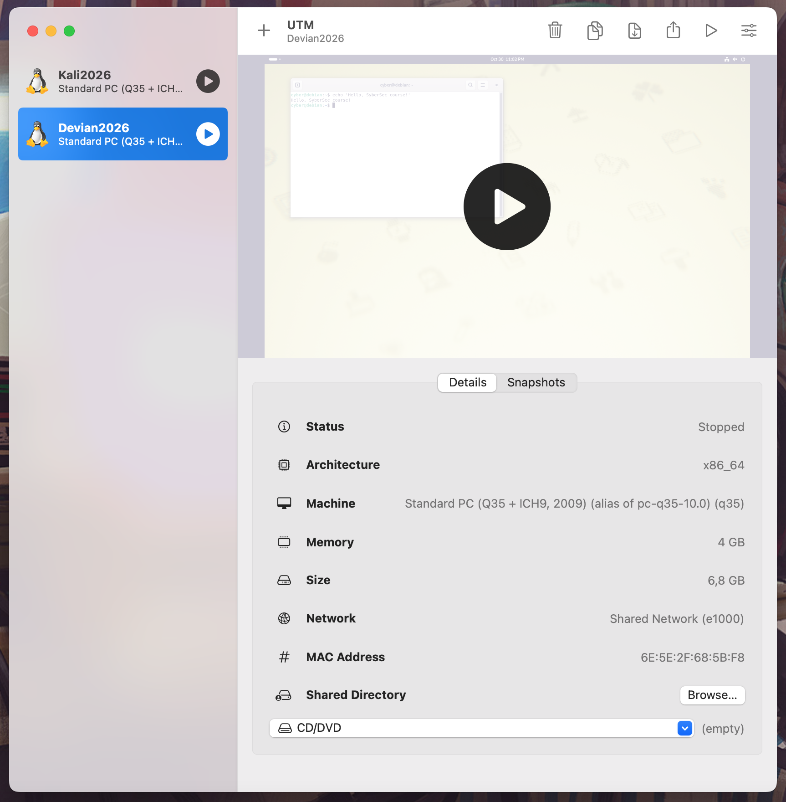
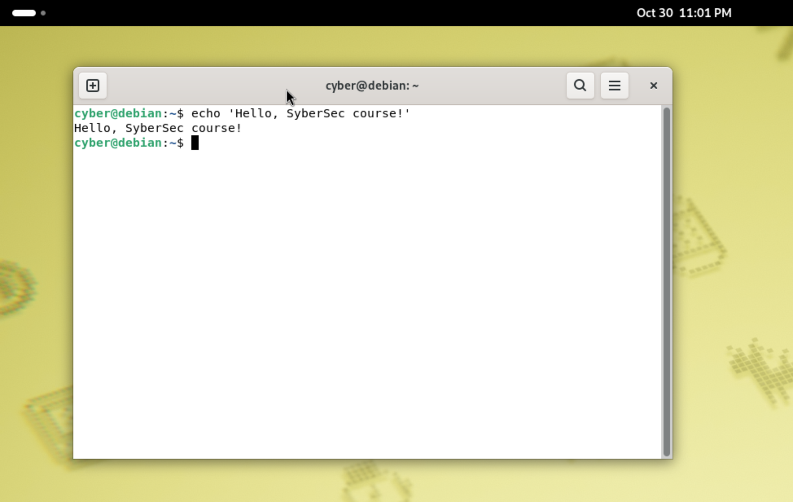

# H2_Scene

## Following the scene (working title)

### Podact

Text

### Blog

Text

### Science

Text

## Debian

- Downloaded Debian NetInstaller for 64-bit PC (amd64): [https://www.debian.org/download](https://www.debian.org/download)

## Voluntary tasks

### Install Debian

- UTM Virtual machine software was [downloaded and installed](h1-cyber-science.md#installing-linux-on-a-virtual-machine) previously: 
- Created virtual machine using Debian image.

*Figure 1. UTM software with Debian VM details*

*Figure 2. Debian desktop with Terminal window opened*

### Feed reader

Text

### More content

Text

## References
* Karvinen, T. 2026. Cyber Security – 2026 late autumn, homework h1 CyberScience. Accessed: 24 October 2026. [https://terokarvinen.com/cyber-security/#h1-cyberscience](https://terokarvinen.com/cyber-security/#h1-cyberscience).