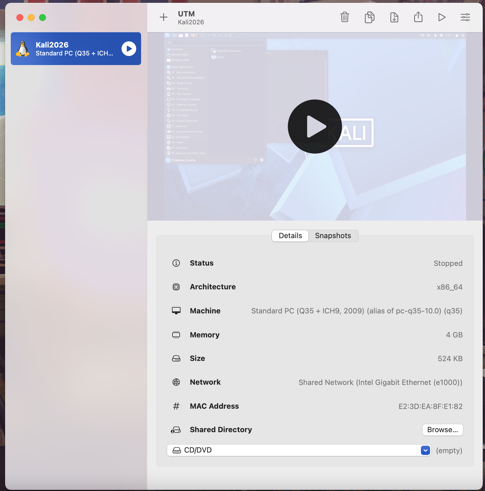

# H2_Scene

## Following the scene (working title)

### Podact

Text

### Blog

Text

### Science

Text

## Debian

Debian

## Voluntary tasks

### Install Debian

Steps and screenshots
- Downloaded UTM Virtual machine software: [https://getutm.app](https://getutm.app)

*Figure 2. Kali desktop with Terminal window opened*

### Feed reader

Text

### More content

Text

## References
* Karvinen, T. 2026. Cyber Security – 2026 late autumn, homework h1 CyberScience. Accessed: 24 October 2026. [https://terokarvinen.com/cyber-security/#h1-cyberscience](https://terokarvinen.com/cyber-security/#h1-cyberscience).