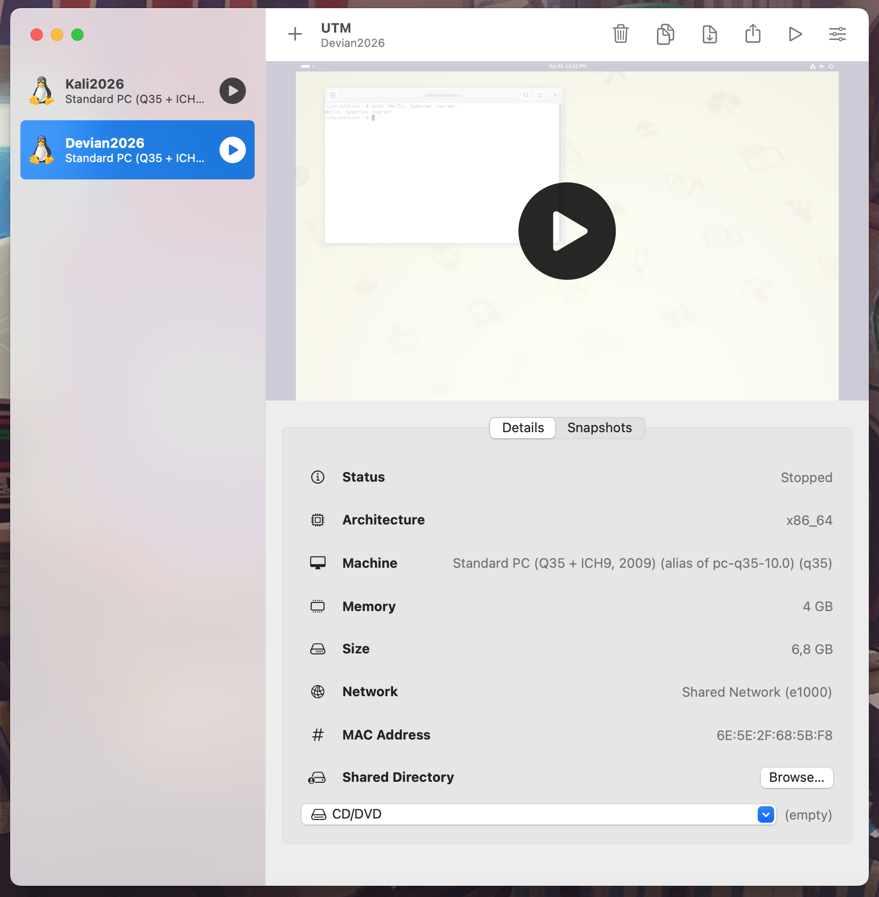
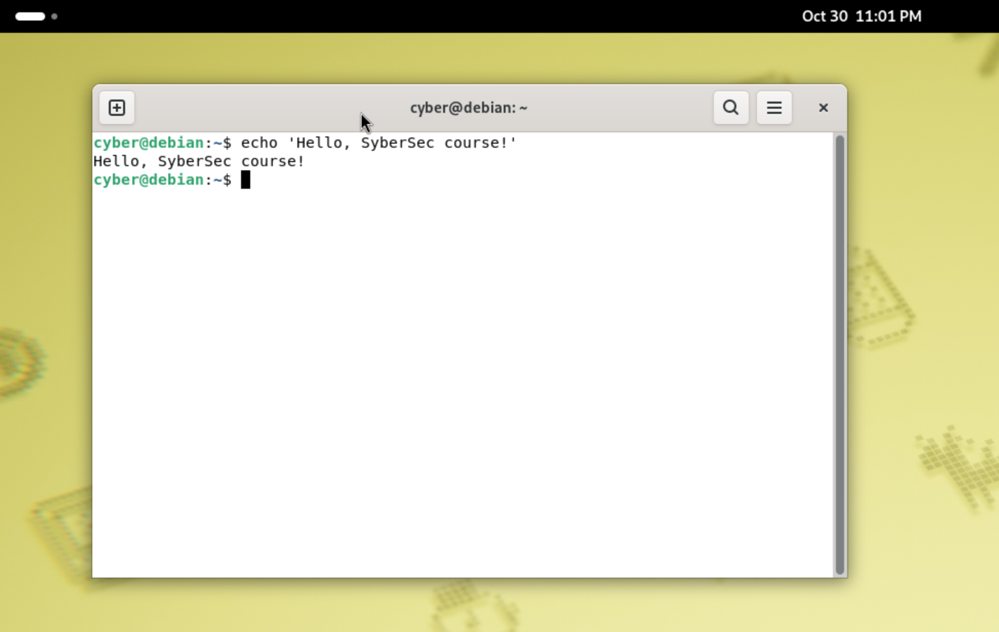
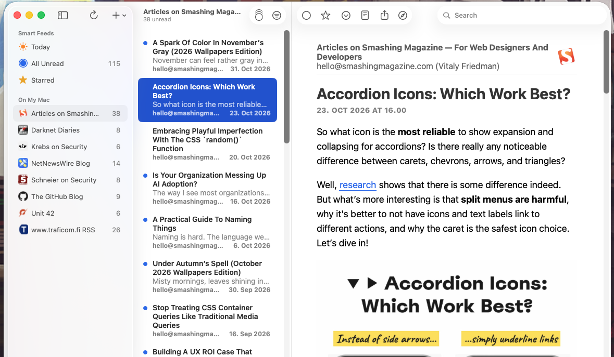

# H2_Scene

## Following the scene

### Podcast

I listened to [Episode 144: Rachel](https://darknetdiaries.com/episode/144/) of the Darknet Diaries podcast. Frankly, I listened to this particular episode when it was released in April 2024, because I follow the podcast, and listened to it again for this task. I chose specifically this one because I like the subject of social engineering, and this episode shows explicitly that if an ethical hacker with good intentions can do such tricks to their targets, differently motivated bad guys can do much more damage.

---

The episode starts with Jack Rhysider, host of the show, recalling a stock scam attempt that happened to him in his college years. Scammer gave people they called opposite prediction on stock market changes, creating an impression that he was a successful trader, who had a special formula.

Then the episode introduces main guest Rachel Tobac, ethical hacker and social engineer, who went an unusual path to cyber security. Rachel studied neuroscience and behavioral psychology, and never learned how to code. Her husband inspired her to participate in DEF CON's social engineering contest, where contestants live have to manipulate some companies' employees to leak sensitive corporate information. Rachel got second place three times in a row. 

The major part of the episode focuses on three cases Rachel participated in as an ethical hacker, as she is running and working in the company that provides security consulting, including penetration testing. 

**Bank penetration test.** The bank chat support refused to make exceptions for the "client" who lost her phone and laptop and couldn’t access her email while traveling abroad. Rachel then spoofed the customer's number and reached support with her "edge case". She provided edited images of identity documents and got access to the test account within two days. As an outcome of this pentest she recommended the bank to implement fixes such a as callbacks and verification codes.

**Merger and acquisition leaks (M&A).** Rachel's task was to find out how M&A info was getting leaked. Her first attempt as a journalist didn't succeed, so she decided to apply for product manager role, got through interviews (and basically almost got a real offer). During the interviews she managed to get hints from three of six interviewers about upcoming acquisitions. The company concluded that leaks came from employees talking "in generalities", not from an insider, and made communication rules stricter.

**60 Minutes demonstration.** Rachel was writing on Twitter how she was seeing AI get used by criminals to trick people. Because of that activity she then was reached and asked to pretend to be Sharyn Alfonsi, host of 60 Minutes show. With consent, Rachel cloned Sharyn's voice using available public videos and audios, spoofed her number and got her colleague Elizabeth to read Sharyn's passport number.

Jack then explains that he is narrating the episode already for several minutes with his cloned voice. The episode concludes with a discussion of AI voice and video deepfakes. Another guest Daniel Miessler supposes that we will need ways to verify who we are talking to.

---

💡 An attacker who understands human psychology can convince other people of their good intentions and overcome even security policies. Policies are only as strong as the people who follow them.

### Blog

I read [The Current Landscape of OAuth Attacks](https://unit42.paloaltonetworks.com/current-landscape-oauth-attacks/) (Kaleli, Marty, Starov & He 2026) from the Unit 42 blog. The title caught my attention, because I'm interested in the authentication/authorization subject, and for a developer knowing what threats OAuth can be exposed to is interesting and important.

* Attackers have adapted to multi-factor authentication (MFA) by stealing Open Authorization (OAuth) tokens.
* OAuth tokens' advantages over passwords are lost in practice: tokens are designed to be short-lived, but are often configured to be long-lived, and they survive password resets.
* OAuth became the new attack surface.
* Long-lived tokens amplify OAuth authorization vulnerabilities: Cross-User OAuth Session Fixation (COSF), Cross-Tenant Client ID Confusion and Cross-Connector OAuth Account Takeover.
* Depending on their goal, attackers use OAuth-based phishing campaigns to make the victim expose a token, consent to the attacker's app, or follow a malicious redirect that delivers malware.
* OAuth phishing has become harder to detect and easier to conduct. Threat actors now hijack sessions that are already authenticated.
* The phishing-as-a-service (PhaaS) economy provides less technical criminals with kits that skilled developers have built. As a result, attackers don't need advanced skills to perform advanced attacks.
* LLMs have lowered the barrier to entry for high-fidelity attacks. Attackers can impersonate brands more convincingly and deploy attacks rapidly.
* Defence strategies exist, and the article recommends defending separately against each attack type.

---

💡 Regardless of how advanced the attacker's toolset is and how sophisticated the countermeasures are, in most of these attacks the weakest point is the human. In the first place, it is the user who is being hacked, not the authorization flow.

### Science

Below are the connections showing how the reviewed article [from h1](h1-cyber-science.md#review-of-the-article) links to the podcast episode and the blog article. 

The connections are laid out as in the following example:

* **Connection**
  - h1 review
  - Darknet Diaries, ep. 144
  - Unit 42 blog

---

* Humans are the main target
	- Phishing exploits decisions, not technical flaws (p. 1, 11)
	- Every example used people as vulnerabilities, not code
	- The victim pastes a code or clicks "Allow"

* Authority, urgency, fear
	- Strongest triggers (p. 12–13)
	- Abroad without money; the "boss" needs a passport number right now
	- Brand faking; trust in real Microsoft or Google pages

* Knowing isn’t doing
	- Training fails under pressure (p. 14–15)
	- Interviewers were aware about the rule but leaked information "in generalities"
	- User awareness the "final line of defense", which is in tension with the review

* Multiple channels
	- Attackers use to the weakest channel (p. 19)
	- Rachel switched from chat to phone to email with fake documents
	- Security codes pasted into chat apps

---

## Debian

- Downloaded Debian 13 (Trixie) for 64-bit PC (amd64): [https://www.debian.org/download](https://www.debian.org/download)

## Voluntary tasks

### Install Debian

- UTM Virtual machine software was [downloaded and installed](h1-cyber-science.md#installing-linux-on-a-virtual-machine) previously.
- Created virtual machine using Debian image.

*Figure 1. UTM software with Debian VM details*

*Figure 2. Debian desktop with Terminal window opened*

### Feed reader

I have downloaded and installed [NetNewsWire](https://netnewswire.com/) RSS reader and subscribed to several feeds. I must admit, surfing through all recent updates became extremely convinient; I have no excuse why I didn't use RSS feed readers before.

*Figure 3. NetNewsWire interface with list of subscriptions.*

### More content

* Rhysider 2026: [Darknet Diaries, Episode 181: Ricky](https://darknetdiaries.com/episode/181/). Published 20.10.2026.
* Unit 42 2026: [Threat Brief: Critical Vulnerabilities in PHP: CVE-2026-109618, CVE-2026-109619](https://unit42.paloaltonetworks.com/cve-2026-109618-cve-2026-109619/). Unit 42, Palo Alto Networks. Published 29.10.2026.
* Harris 2026: [Podcast With Rene Mattheus](https://covertaccessteam.substack.com/p/podcast-with-rene-mattheus?utm_source=publication-search). Published 4.09.2026.

## References
* Gagniuc, P. A. 2026. Why educated users still click: a review on phishing and the limits of human judgment. Computer Science Review, 62, 101025. [https://doi.org/10.1016/j.cosrev.2026.101025](https://doi.org/10.1016/j.cosrev.2026.101025).
* Kaleli, Marty, Starov & He 2026: [The Current Landscape of OAuth Attacks](https://unit42.paloaltonetworks.com/current-landscape-oauth-attacks/). Unit 42, Palo Alto Networks. Published 22.10.2026, updated 26.10.2026.
* Karvinen, T. 2026. Cyber Security – 2026 late autumn, homework h1 CyberScience. [https://terokarvinen.com/cyber-security/#h2-scene](https://terokarvinen.com/cyber-security/#h1-cyberscience).
* Rhysider 2024: [Darknet Diaries, Episode 144: Rachel](https://darknetdiaries.com/episode/144/). Published 2.4.2024.