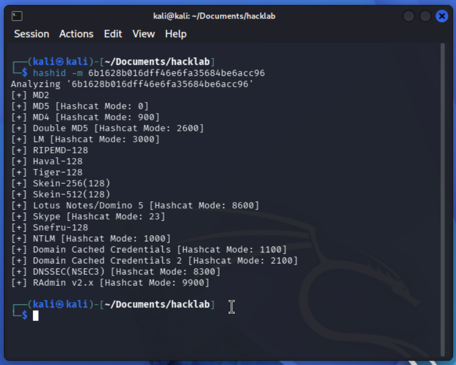
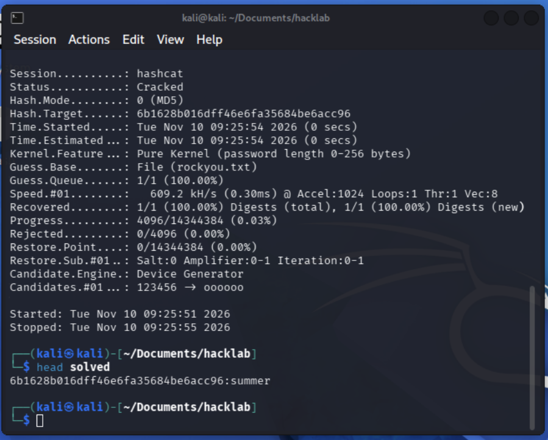

# H3_CyberLab

## x. Read and summarize

### How to Install Linux to Virtualbox?

* The manual focuses on installing Debian Linux 13.x (Trixie) on VirtualBox running on Windows.
* VT-x must be enabled in the host's UEFI/BIOS before installing VirtualBox, to enable hardware support for virtualization.
* Debian 13.x can be downloaded from the official Debian site. The downloadable file is in ISO format, a "digital replica of the disk".
* A distribution is a customized version of Linux, built on top of the Linux kernel. It adds a package manager, desktop environment, applications and basic utilities.
* To install an operating system on a VirtualBox virtual machine, the VM must be assigned RAM, CPUs and disk space (Minimum 2048 MB RAM (4096 MB recommended), 2 CPUs, EFI enabled, and a 20–40 GB disk.), and the ISO must be mounted.
* Before the real installation, Debian can be tested for hardware compatibility in a live session (Live install), and then installed fully (Real installation).
* After the system is installed, it is important to update the package list and upgrade the system by running the following commands in Terminal:
  ```sh
  sudo apt-get update
  sudo apt-get upgrade
  ```
* **Personal notes:**
  * I'm using a Mac, so I use [UTM](https://getutm.app/) to create virtual machines.
  * In UTM, the ISO must be removed from the virtual CD/DVD drive after installation, so that the installed Linux starts on the next boot instead of the installer.

### Command Line Basics Revisited

* The article focuses on essential commands that can be used in a terminal shell.
* The Moving and looking around section describes commands for checking the current directory (`pwd`), listing files (`ls`), changing directories (`cd docs/`, `cd ..`), viewing text files (`less hello_world.txt`) and reading long command output one page at a time (`ls /etc|less`).
* The File Manipulation section shows how to edit files right in the terminal with the Nano editor (`nano notes.txt`), create directories (`mkdir`), move or rename files and directories (`mv`), copy them (`cp -r`) and delete them (`rm`, `rm -r`, `rmdir`). There is no trash, so deleted files are gone for good.
* The SSH Remote Control section briefly shows how to start a remote session (`ssh tero@example.com`), end it (`exit`) and securely copy files to a remote machine (`scp -r`).
* The Help section explains how to (naturally) get help for particular commands (`man ls`, `ls --help`).
* The `history` command, searching history with Ctrl-R, the arrow keys and Tab completion save time, so the user doesn't need to retype frequently used commands or recently used paths. Tab completion also prevents typos.
* Linux has a filesystem hierarchy that is the same across all Linux systems, defined in the Filesystem Hierarchy Standard. Knowing key directories such as `/home/`, `/etc/` and `/var/log/` is important for navigating via the terminal.
* Linux can be administered via the terminal too: updating the package list (`sudo apt-get update`), searching for (`apt-cache search`), installing (`sudo apt-get -y install`) and removing packages (`sudo apt-get purge`). Following the principle of least privilege, only commands that affect the whole system are run with `sudo`.
* **Personal notes:**
  * To work in the terminal comfortably, it is important to build a mental model of the filesystem hierarchy.
  * The commands mentioned are just the essentials, though very important ones, but there are [many more of them](https://ss64.com/bash/).

### Cracking Passwords with Hashcat

* Systems store passwords as hashes, not as the original text. Hashing is a one-way function, so a hash cannot be turned back into a password directly.
* Instead, a tool can hash every word in a dictionary and check whether any result matches the target hash. If it matches, that word is the password.
* Penetration testing techniques, including password cracking, require ethical and legal considerations. Only work on your own hashes or given practice targets.
* `hashcat` is a tool for cracking passwords this way, using a wordlist such as the leaked `rockyou` database of over 14 million passwords.
* First, the hash type must be identified using `hashid`, and then the hash can be cracked with `hashcat` (for example, `hashcat -m 0 '<hash>' rockyou.txt -o solved`).
* Running `hashcat` on a real machine rather than in a virtual environment is much faster, because it can use the computer's GPU.

## a. Hello, Friend: A Security Mindset Through Mr. Robot 

Presentation is scheduled on December 12, 2026, w50.

## b. Linux

I have installed Linux, [Kali](https://mityaustinov.github.io/cybersec-course/h1-cyber-science.html#installing-linux-on-a-virtual-machine-) and [Debian](https://mityaustinov.github.io/cybersec-course/h2-scene.html#install-debian-) as voluntary tasks for homeworks h1 and h2.

## Voluntary bonuses

### c. Crack. 

First I identified hash type



*Figure 1. Hash type identification*

Then I run `hashcat` to find a match in `rockyou` dictionary and store the result in `solved` text file. 

```bash
hashcat -m 0 '6b1628b016dff46e6fa35684be6acc96' rockyou.txt -o solved
```



*Figure 2. Password cracking and showing the result*

Already cracked matches are also stored in hashcat's `.potfile`. Running hashcat on the same hash again won't crack it. To view the result the command must be ran with `--show` parameter.

``` bash
hashcat -m 0 '6b1628b016dff46e6fa35684be6acc96' rockyou.txt --show
```

If for some reason you want all previous cracks cleared, you can delete the `.potfile`


*Figure 3. Clearing hashcat .potfile*

`6b1628b016dff46e6fa35684be6acc96:summer` It's a pretty weak password.

UPD: **Personal notes**
  * Provided hash was for practice only. Having the means to get someone's password doesn't make it right to do so. Whether you can see someone typing their password or you have access to leaked hashes, the ethical move would be not to use it. Just as a decent person turns their eyes from a screen when someone types a PIN or password, a decent person with the skills to crack a hash chooses not to, unless they have permission.
  * Hashing protects stored passwords, so a leaked database doesn't immediately reveal them. On its own it's weaker than it used to be, because fast hashes like MD5 can be brute-forced quickly. Adding a unique "salt" to each password is a standard improvement.

### d. John the Ripper

Coming soon.

### e. The other John

Comimng soon.

## References

* Heinonen, J. n.d.: [How to Install Linux to Virtualbox?](https://github.com/johannaheinonen/johanna-test-repo/blob/main/module_1.md) GitHub repository johanna-test-repo.
* Karvinen, T. 2020: [Command Line Basics Revisited](https://terokarvinen.com/2020/command-line-basics-revisited/).
* Karvinen, T. 2022: [Cracking Passwords with Hashcat](https://terokarvinen.com/2022/cracking-passwords-with-hashcat/).
* Karvinen, T. 2026. Cyber Security – 2026 late autumn, homework h3 Cyber lab. [https://terokarvinen.com/cyber-security/#h3-cyber-lab](https://terokarvinen.com/cyber-security/#h3-cyber-lab).