# H4_FeedMe

## x. Why to use a feed reader (and RSS/Atom)?

A feed reader is a convenient way to follow different sources in one place. A person who systematically reads several different sources has to visit all of them regularly, for example daily, and pick out interesting articles or important announcements. A feed reader solves this problem. It checks the feeds a user is subscribed to and removes the need to visit each site in the browser whenever something new is published. It also lets the user read without being distracted by advertisements or unimportant content. In comparison to social media user can decide what can be there in their feed and not algorithms. 

From a cyber security point of view, feeds like [Unit 42](https://unit42.paloaltonetworks.com) provide up-to-date information about recently found vulnerabilities, which can be very important for those who need to be informed as soon as possible.

Some feeds publish whole articles, which allows reading offline, during a flight for example.

RSS and Atom don't necessarily require a feed reader. A feed can even be read in the terminal, though it isn't convenient, since the output is raw XML:

```bash
curl -L https://www.schneier.com/feed/
```

For the terminal, dedicated software such as [Newsboat](https://newsboat.org/) works better.

A feed reader is the software, while RSS and Atom are standardized formats used to publish a feed. News or update feeds from an organization can also be delivered through this channel.

In short, feed readers save time and help you focus on what matters.

## y. Osuuspankkikeskus port scan KKO:2003:36 

This case shows how important it is to understand the possible consequences of actions taken online, whether the intentions behind them are good or bad.

A 17-year-old computer enthusiast attempted to gain access to the network of Osuuspankkikeskus-OPK. He used a specialised program to perform a port scan in order to:

* scan the organisation's network for open proxy servers;
* find a way to connect to the internet through those servers;
* conceal the real origin of his connection.

The attempt did not get through the organisation's firewall, but the case still offers several important lessons:

* An unsuccessful intrusion attempt can still be a crime.
* Harm does not require data to be destroyed. Having to review and strengthen security systems is itself a cost to the organisation.
* Technical expertise can increase responsibility.
* Good intentions, or the lack of a specific target, do not necessarily provide a defence.

The main takeaway of KKO:2003:36 is that attempting to gain unauthorised access to a protected computer system can create both criminal and financial liability, even when the attempt fails and no data is compromised. The court recognised that an attack can generate real costs for an organisation, independently of any data breach.


## a&ndash;e. Reader and feeds

I have previously, as a [voluntary task](h2-scene.md#feed-reader) already installed [NetNewsWire](https://netnewswire.com/) RSS reader and subscribed to several feeds.

<figure>
  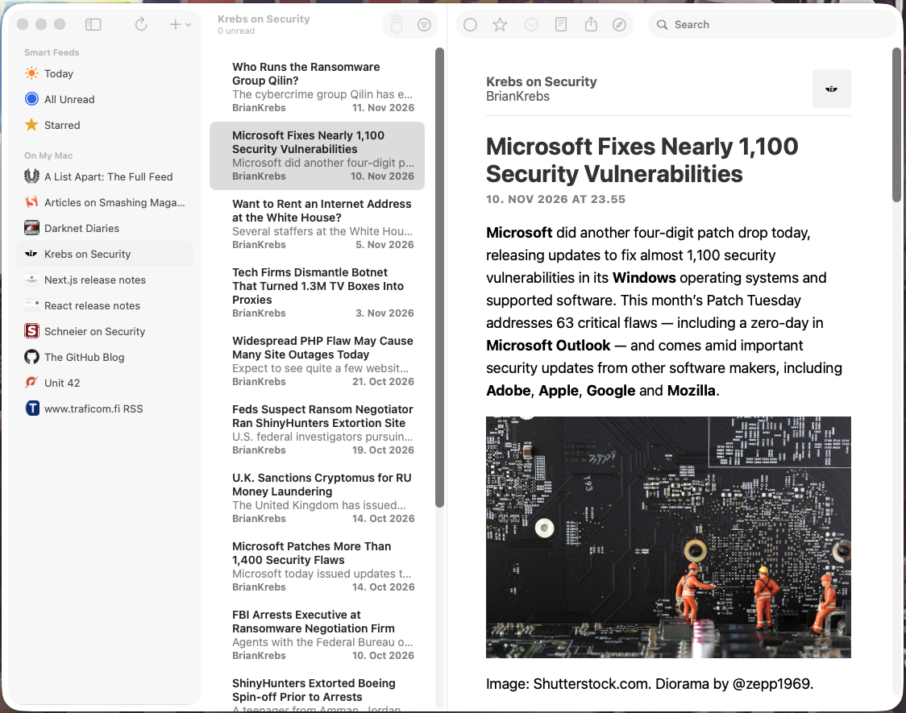
  <figcaption><em>Figure 1. NetNewsWire interface with list of subscriptions and opened article.</em></figcaption>
</figure>

* [Krebs on Security](https://krebsonsecurity.com/feed/) (Fig. 1)
* [Schneier on Security](https://www.schneier.com/feed/) (Fig. 1)
* I'm also subscribed for several other feeds:
	* [DarknetDiaries](https://podcast.darknetdiaries.com/) I follow the podcast already for six years now, but it is more convenient to learn about a new episode this way than check, for example in Spotify. I searched for "darknet diaries RSS feed".
	* [Unit 42](https://unit42.paloaltonetworks.com/feed/) Recent updates on cyber security threats. I simply added `/feed` to the address I knew. 
	* [NextJS Release Notes](https://github.com/vercel/next.js/releases.atom) and [React Release Notes](https://github.com/react/react/releases.atom) These are important, because I work a lot with ReactJS and NextJS and sometimes it is important to learn quickly, that a new version has been released. GitHub provides such feeds for public repositories.
 
As I [mentioned before](h2-scene.md#feed-reader), I started using feed reader a while ago. I noticed that my daily "tech news" routine became much more efficient. I simply watch through the feed and as before decide what to read more thoroughly, but now it takes less time. However, there are downsides. Sometimes it can be too much information even to quickly scroll through. Not every source that I typically follow provides RSS/Atom feed. Some entries are very brief about the content or have no summary at all and I need to check the site if that article is something that I really need to read. Nevertheless, the reader gives a very nice experience, because I'm less distracted.


## f. Port scan

For lab purposes I'm using a [VM with Kali](h1-cyber-science.md#installing-linux-on-a-virtual-machine), so there was no need to install `nmap`, since it is pre-installed in Kali.

<figure>
  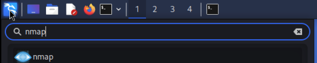
  <figcaption><em>Figure 2. Kali dashboard shows nmap found already installed in system.</em></figcaption>
</figure>

With that confirmed I ran the `ping 8.8.8.8` command. Google's primary public DNS is located on that IP address, and as Figure 3 shows, my client sent and received packets successfully.

<figure>
  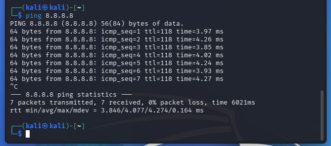
  <figcaption><em>Figure 3. Pinging 8.8.8.8.</em></figcaption>
</figure>

After that I turned off the Internet connection on the Kali VM and ran `ping 8.8.8.8` again. The network was unreachable this time, as seen on Figure 4.

<figure>
  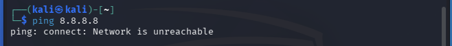
  <figcaption><em>Figure 4. Network is unreachable.</em></figcaption>
</figure>

After that I ran `sudo nmap -A -v localhost` for the first time and scanned the ports.

<figure>
  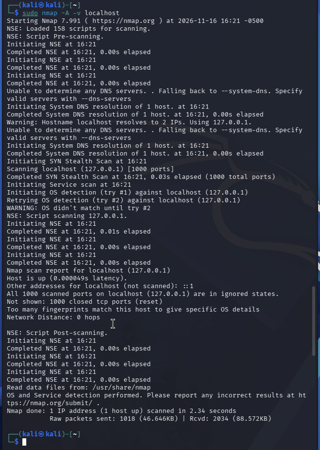
  <figcaption><em>Figure 5. nmap port scanning output.</em></figcaption>
</figure>

Among other lines in the output, some of the most informative for this case were these:

```bash
All 1000 scanned ports on localhost (127.0.0.1) are in ignored states.
Not shown: 1000 closed tcp ports (reset)
```

This means that `nmap` scanned 1000 ports and they were all closed.

I then installed a daemon, in this case `openssh-server`, and started it.

```bash
sudo apt-get install openssh-server
sudo systemctl start ssh
```

<figure>
  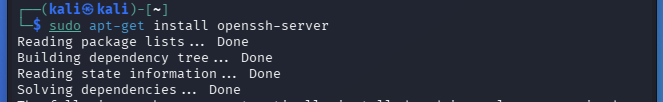
  <figcaption><em>Figure 6. Installing openssh-server.</em></figcaption>
</figure>

And ran the port scan again. This time the output was different.

<figure>
  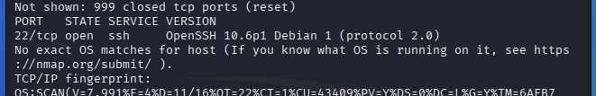
  <figcaption><em>Figure 7. Port 22 is open.</em></figcaption>
</figure>

`nmap` discovered an open port:

```bash
Not shown: 999 closed tcp ports (reset)
PORT   STATE SERVICE VERSION
22/tcp open  ssh     OpenSSH 10.6p1 Debian 1 (protocol 2.0)
```

Next I installed the Apache server and started it as well.

```bash
sudo apt-get install apache2
sudo systemctl start apache2
```

Scanning the ports this time showed another change in the output, as seen on Figure 8. Port 80 now appears as open, running `Apache httpd 2.4.68`.

<figure>
  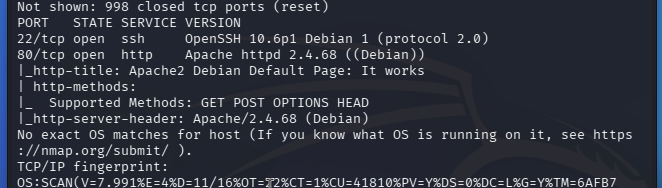
  <figcaption><em>Figure 8. Ports 22 and 80 are open.</em></figcaption>
</figure>

## Voluntary bonuses

### g. Identify a port scan against Apache

Next, I opened another terminal window and read the Apache access log with this command:

```bash
sudo grep "127.0.0.1" /var/log/apache2/access.log | tail
```

<figure>
  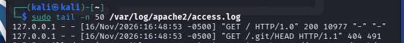
  <figcaption><em>Figure 9. Reaching Apache access log.</em></figcaption>
</figure>

Since I read the log with `sudo`, I have the rights to access it. The latest entries in the log showed that Apache was accessed by `nmap`.

```bash
127.0.0.1 - - [16/Nov/2026:16:49:41 -0500] "OPTIONS / HTTP/1.1" 200 181 "-" "Mozilla/5.0 (compatible; Nmap Scripting Engine; https://nmap.org/book/nse.html)"
```

This means that Apache recorded that the Nmap scanner, and not a regular browser, had tried to access it. The `-A` scan runs service and script detection, which actually sends HTTP requests to Apache, and those requests are what the log captured. In other words, this is the proof of my previous scan.

<figure>
  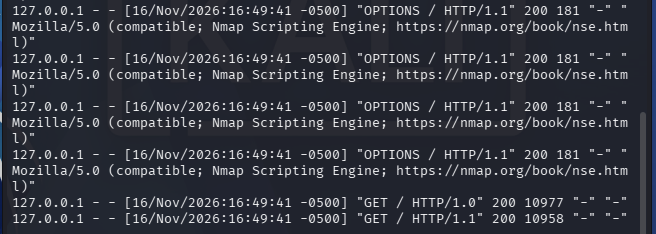
  <figcaption><em>Figure 10. Nmap requests logged in Apache log.</em></figcaption>
</figure>

### h. Modify nmap scan

All previous scans were performed in an open manner. This time I ran the scan with a different parameter:

```bash
sudo nmap -sS localhost
```

This is a "stealth" scan. Its output is shorter and takes less time, because in this case `nmap` didn't communicate with the daemons, as it did in the previous scans.

<figure>
  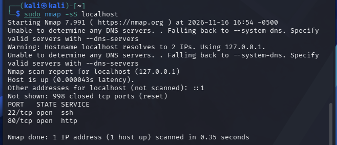
  <figcaption><em>Figure 11. The output of nmap scan with stealth parameter.</em></figcaption>
</figure>

Reading the Apache log again showed that Apache didn't log the last scan. The most recent entries were the same as several minutes earlier.

<figure>
  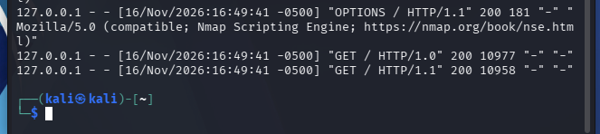
  <figcaption><em>Figure 12. Apache log remained the same.</em></figcaption>
</figure>

What happened is that with the `-sS` parameter, `nmap` reached the target but never completed a connection and stopped it, leaving no traces in Apache's log. Even though this scan does not attempt OS detection, it still disclosed which ports were open and which protocol they used.


## References

* Karvinen, T. 2026. Cyber Security – 2026 late autumn, homework h4. Accessed 16.11.2026. [https://terokarvinen.com/cyber-security/#h4-feed-me](https://terokarvinen.com/cyber-security/).
* Korkein oikeus. 2003. KKO:2003:36. [Precedent, Supreme Court of Finland]. Accessed 16.11.2026. [https://www.finlex.fi/en/case-law/supreme-court/precedents/2003/36](https://www.finlex.fi/en/case-law/supreme-court/precedents/2003/36).